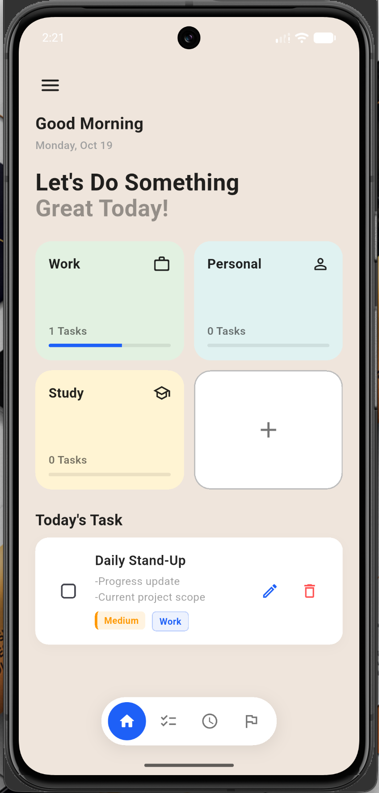
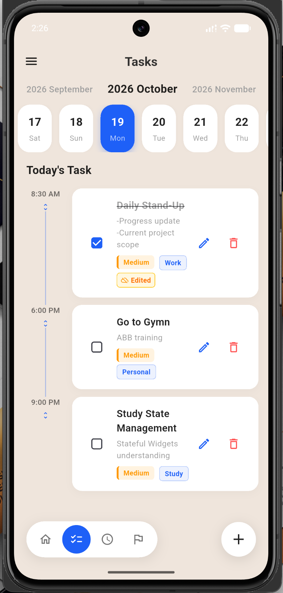
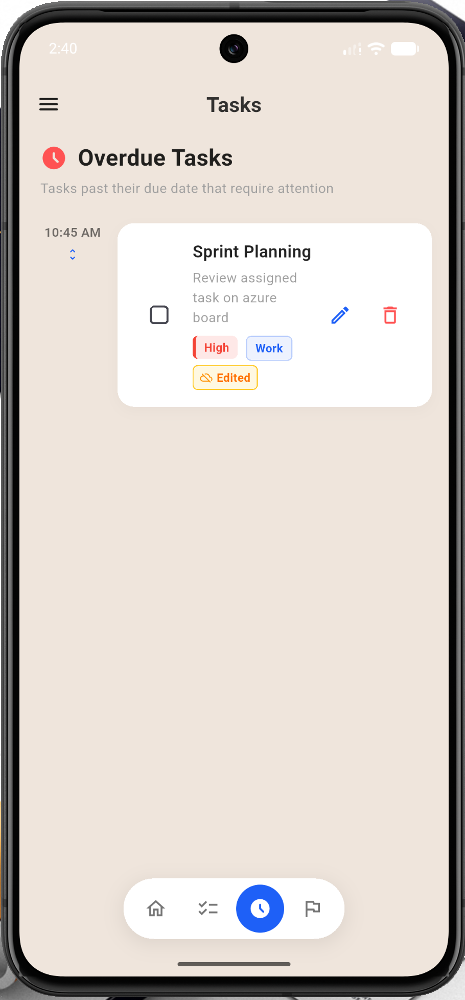
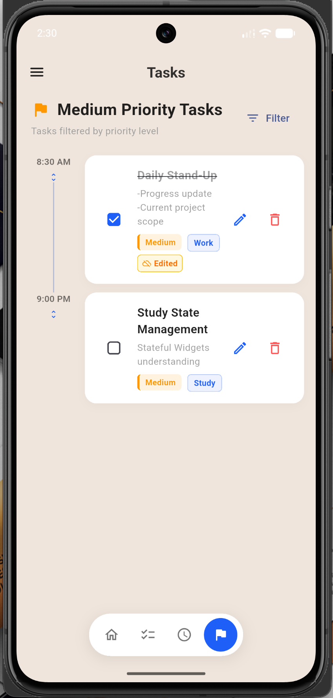
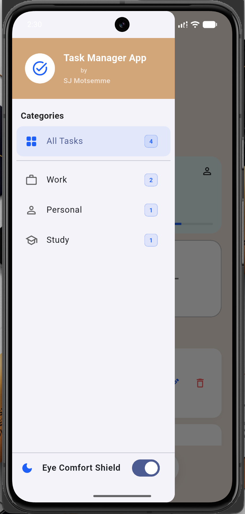
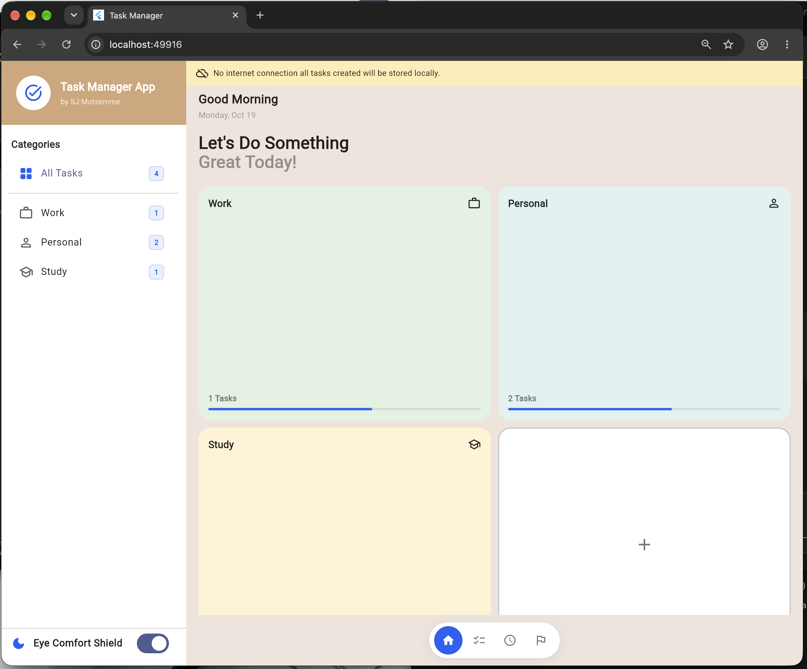
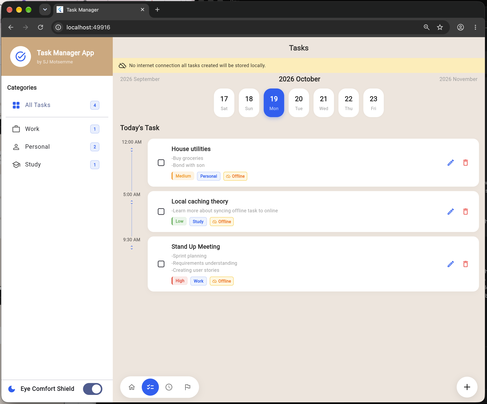
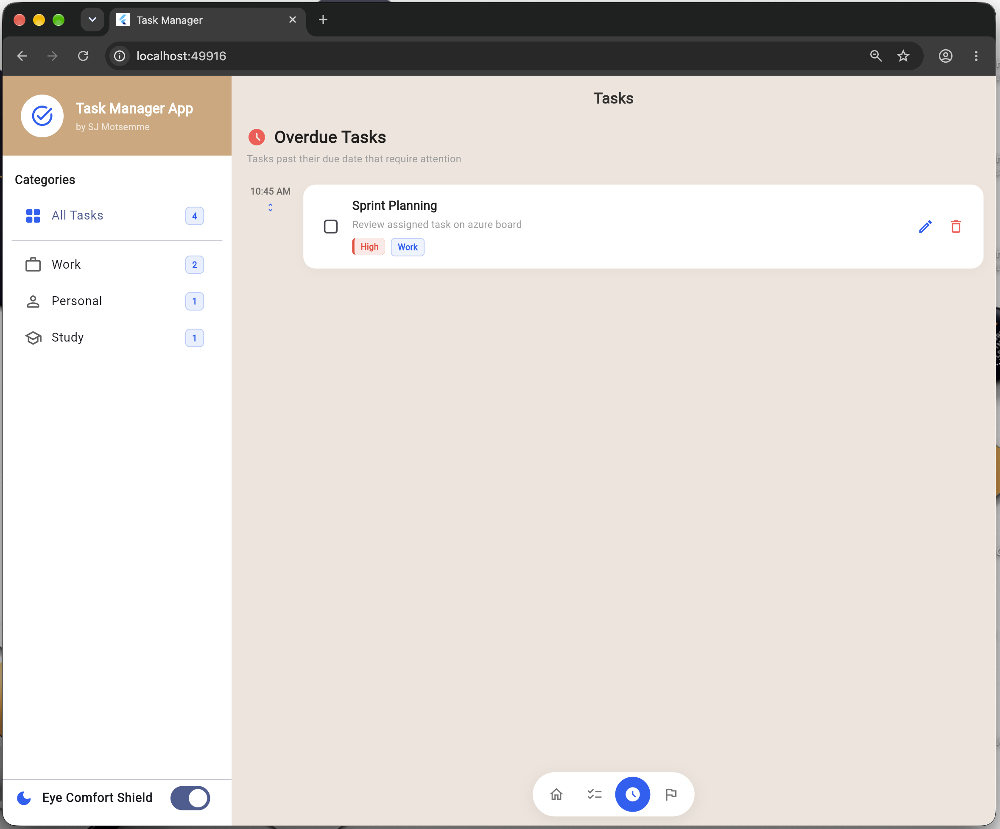
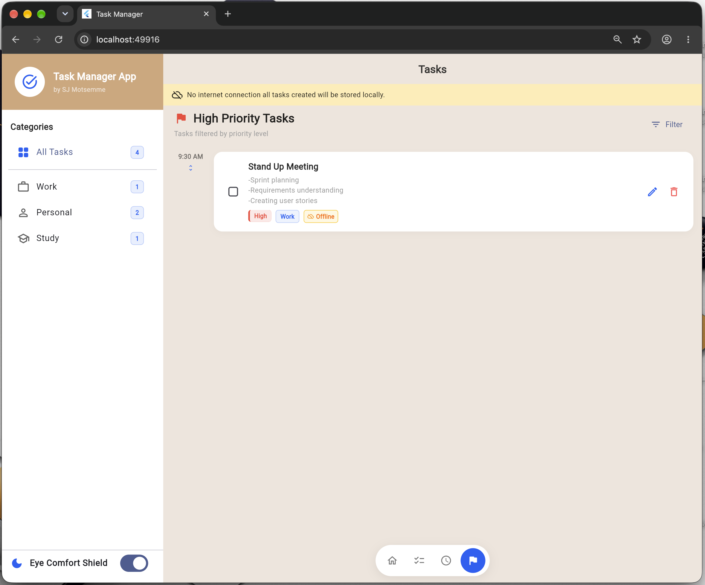

# Task Manager

A task management app built with Flutter and an ASP.NET Core REST API. The Flutter app supports mobile, web, and desktop layouts. It can read cached tasks when the API is unavailable, and syncs normal task changes with the API.

## Screenshots

### Mobile app








## Project layout

```text
TaskManagementApp/
├── TaskManagerApi/             # ASP.NET Core API
└── task_manager_flutter/       # Flutter client (this directory)
    ├── lib/
    └── test/
```

## Requirements

- Flutter SDK with Dart `3.13.2` as required by `pubspec.yaml`
- .NET 10 SDK
- An android emulator and browser supported by Flutter

Check the installations with:

```sh
flutter --version
flutter doctor
dotnet --version
```

## Running the app locally

Start the API first. From the repository's `TaskManagerApi` directory:

```sh
cd ../TaskManagerApi
dotnet restore
dotnet run --launch-profile http
```

The HTTP launch profile listens on port `5164`. In Development, Swagger is available at [http://localhost:5164/swagger](http://localhost:5164/swagger).

In another terminal, from this Flutter project directory:

```sh
flutter pub get
flutter run
```

To run in a desktop or browser target, for example Chrome:

```sh
flutter run -d chrome
```

The API and Flutter app run as separate processes. Keep the API running while using the app if you want live task data and task changes to reach the server.

## API configuration

The Flutter client selects its base URL in [`lib/config/api_config.dart`](lib/config/api_config.dart):

| Flutter target | Default API base URL |
| --- | --- |
| Web | `http://localhost:5164/api` |
| Android emulator | `http://10.0.2.2:5164/api` |


`10.0.2.2` is the Android emulator's address for reaching the host computer. If you run the app on a physical phone or a different host, update `ApiConfig.baseUrl` to use an address the device can reach, for example `http://192.168.1.20:5164/api`. The phone and computer need network connectivity to each other, and the API must listen on an interface reachable from the device.

The API's `http` launch profile binds to `0.0.0.0:5164`. CORS currently allows any origin, header, and method to make local web development work.(NB!!Restrict this policy before exposing the API beyond a development environment).

## API contract

All endpoints use the `/api/Tasks` route. Requests and responses use JSON with camel-case property names. Priority is represented as a number: `0` = Low, `1` = Medium, `2` = High.

### Task object

```json
{
  "id": 1,
  "title": "Prepare project demo",
  "description": "Review the task flow",
  "isCompleted": false,
  "priority": 1,
  "category": "Work",
  "dueDate": "2026-10-15T09:00:00Z",
  "createdAt": "2026-10-01T10:00:00Z"
}
```

`title` is required. `description`, `category`, and `dueDate` may be `null`. Dates should be ISO 8601 date-time strings. On create, the server assigns `id` and `createdAt`; the values supplied for those fields are ignored. If `category` is empty or omitted, the server defaults it to `"Personal"`.

### Endpoints

| Method | Path | Description | Success response |
| --- | --- | --- | --- |
| `GET` | `/api/Tasks` | List all tasks | `200 OK`, JSON array |
| `GET` | `/api/Tasks/{id}` | Get one task | `200 OK`, task object |
| `POST` | `/api/Tasks` | Create a task | `201 Created`, created task |
| `PUT` | `/api/Tasks/{id}` | Replace editable task fields | `204 No Content` |
| `DELETE` | `/api/Tasks/{id}` | Delete a task | `204 No Content` |

For example, create a task with:

```sh
curl -X POST http://localhost:5164/api/Tasks \
  -H "Content-Type: application/json" \
  -d '{
    "title": "Prepare project demo",
    "description": "Review the task flow",
    "isCompleted": false,
    "priority": 1,
    "category": "Work",
    "dueDate": "2026-10-15T09:00:00Z"
  }'
```

The API returns `404 Not Found` when a requested task ID does not exist. Invalid model input is rejected with `400 Bad Request`.

## Architecture

### Flutter client

```text
Views (mobile / desktop / task details)
              ↓
         View models
       (Provider state)
              ↓
          Repository
          ↙       ↘
    API service   Cache service
        ↓          ↙       ↘
  ASP.NET Core   SQLite   Web memory
```

- **Views** renders the responsive homepage,task list, calendar,task detail, overdue and priority screens.
- **View models** hold screen state, filter tasks, and expose task actions to the UI.
- **Repository** coordinates API calls and local caching. The API is authoritative for creates, updates, and deletes. If an API task-list read fails, the repository returns cached tasks when available.
- **API service** sends HTTP requests and translates unsuccessful responses into app errors.
- **Cache service** stores tasks in SQLite on supported native platform(s). On web it uses an in-memory cache, which does not persist after the page is closed.

The main task-list implementations are in [`lib/task_list/`](lib/task_list/), with API and cache access in [`lib/services/`](lib/services/) and [`lib/repositories/`](lib/repositories/).

### ASP.NET Core API

```text
TasksController → ITaskRepository → InMemoryTaskRepository
```

The controller exposes the REST endpoints, and the repository handles task operations. The API currently stores tasks in memory only: all server-side tasks are cleared when the API process stops or restarts. The Flutter cache can provide a fallback for reads, but it does not make the API data persistent.

## Tests and analysis

From this directory, run:

```sh
flutter test
flutter analyze
```

From `../TaskManagerApi`, build the API with:

```sh
dotnet build
```

### Desktop app







